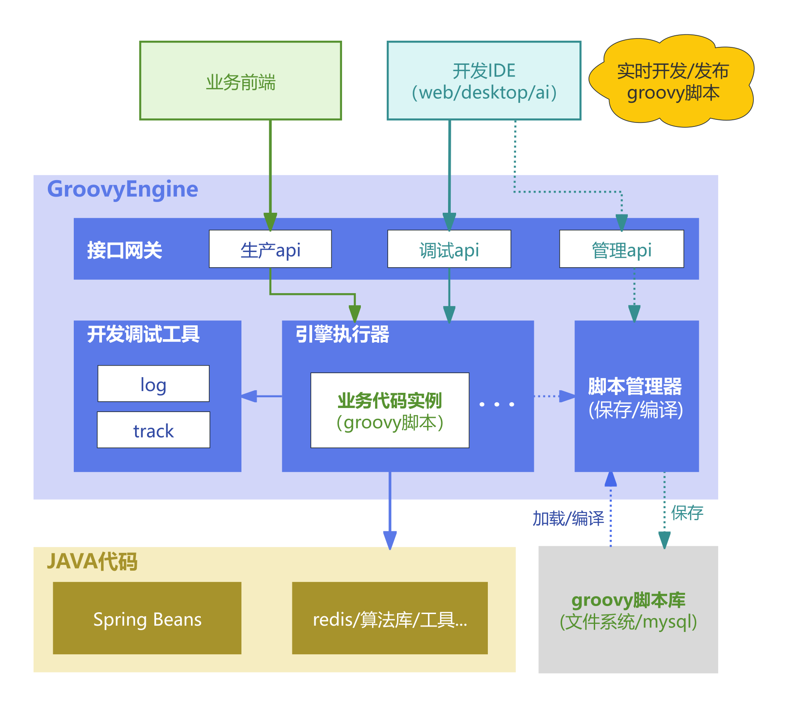

# Groovy Engine

> 状态：已按本地源码核验；本次未启动服务或执行业务测试
> 最近源码核验：2026-11-13
> 适用范围：`main` 分支，项目版本 `1.0.0`
> 事实依据：聚合POM、core/starter/demo模块、管理接口和架构文档

[](LICENSE)
[](https://openjdk.java.net)
[](https://spring.io/projects/spring-boot)

本工程让开发人员在宿主 Java 服务中维护和执行动态业务脚本，适合已有业务服务需要增加查询、计算或组合接口的场景。宿主提供业务上下文、数据存储和正式接口权限，脚本负责约定范围内的业务逻辑；开发人员通过管理HTTP接口或独立IDE编辑和调试，再验证正式调用结果。

本独立引擎的Java脚本接口是 `cn.fengin.groovy.api.IBusinessScript`。工程 `inxvision-iot-platform` 的内嵌实现使用 `com.inxaiot.common.client.groovy.IBusinessScript`，上下文和鉴权也由平台实现。两个IDE当前默认模板使用平台包名，连接本引擎时必须调整导入并核对实际能力，不能直接互换。集成步骤见[快速开始](docs/quick-start.md)，实现与验收边界见[架构说明](docs/architecture.md)。

## ✨ 特性

- **动态加载** — 管理更新后尝试刷新当前进程缓存；编译失败、其他进程缓存和直接改库需要分别核验
- **编译缓存** — 智能 ClassLoader 管理，避免重复编译开销
- **执行追踪** — 返回脚本日志及部分Bean调用信息，不提供断点调试或完整调用链
- **代码补全** — IDE 可获取注入 Bean 的方法签名，提供智能提示
- **Bean访问限制** — Java类 `BeanAccessor` 对经它获取的Bean检查运行时包名前缀；不构成任意脚本的隔离沙箱
- **协作式超时** — 到期中断执行线程，编译时插入中断检查；不能保证终止所有阻塞调用或撤销业务副作用
- **接口文档与分享** — 支持一键生成接口参数文档，并支持免密公开网页分享链接，方便前后端协作
- **Spring Boot集成** — 提供自动装配，宿主仍需准备存储、上下文、身份和正式网关
- **存储可扩展** — 默认 MySQL/H2，可自定义实现 Redis、文件等存储
- **IDE 支持** — 适配 [Groovy Web IDE](https://github.com/user/groovy-web-ide) 和 [Groovy Desktop IDE](https://github.com/user/groovy-desktop-ide)

## 🏗 架构图



## 📦 模块结构

```
groovy-engine/
├── groovy-engine-core                 # 核心引擎（纯 Java，无 Spring 依赖）
├── groovy-engine-spring-boot-starter  # Spring Boot 自动配置 + REST API
└── groovy-engine-demo                 # 演示项目（零配置启动）
```

## 🚀 快速开始

### 1. 运行 Demo

```powershell
git clone https://github.com/fengin/groovy-engine.git
cd groovy-engine
mvn clean package -DskipTests
java "-Dgroovy.engine.manage.api-key=$env:GROOVY_TEST_API_KEY" -jar groovy-engine-demo/target/groovy-engine-demo-1.0.0.jar
```

执行前通过本机环境设置准备环境变量 `GROOVY_TEST_API_KEY`，不要使用业务环境密钥。示例程序使用H2内存数据库，默认端口8080，重启会丢失修改并重新装入示例数据。IDE填写该地址和测试密钥；可按[快速开始中的验收步骤](docs/quick-start.md#最小验收)分别验证管理调试接口和正式示例网关。本次仅核对启动配置与打包声明，未验证当前机器能完成构建启动。

### 2. 集成到你的项目

**第一步：添加依赖**

```xml
<dependency>
    <groupId>cn.fengin</groupId>
    <artifactId>groovy-engine-spring-boot-starter</artifactId>
    <version>1.0.0</version>
</dependency>
```

**第二步：添加配置**

```yaml
groovy:
  engine:
    manage:
      api-key: "${GROOVY_MANAGE_API_KEY}"    # 由宿主环境提供管理密钥
```

**第三步：实现上下文工厂**

下例是宿主应用的Java扩展片段；Java类 `MyQueryService` 是需要宿主实现的示意业务服务。按实际包名导入Java接口 `IScriptContextFactory` 并注册该实现，不会由引擎自动生成业务服务。

```java
@Component
public class MyScriptContextFactory implements IScriptContextFactory {
    
    @Resource
    private MyQueryService queryService;

    @Override
    public Map<String, Object> buildContext(Map<String, Object> params) {
        Map<String, Object> ctx = new HashMap<>();
        ctx.put("params", params);
        ctx.put("queryService", queryService);
        ctx.put("log", LoggerFactory.getLogger("GroovyScript"));
        return ctx;
    }
}
```

**第四步：创建业务网关（可选）**

下例中的Java类 `MyGatewayController` 为宿主示意类，继承已有Java抽象类 `cn.fengin.groovy.spring.web.AbstractGroovyGatewayController`。业务鉴权由宿主配置；管理密钥不自动保护该网关。

```java
@RestController
@RequestMapping("/api/my/gw")
public class MyGatewayController extends AbstractGroovyGatewayController {

    @RequestMapping(value = "/{bizCode}", method = {RequestMethod.GET, RequestMethod.POST})
    public ResponseEntity<?> executeBiz(@PathVariable String bizCode,
                                     @RequestBody(required = false) Map<String, Object> body,
                                     HttpServletRequest request) {
        return super.execute(bizCode, body, request);
    }
}
```

准备默认存储的数据源与数据库表、上下文及网关权限后，再按验收用例验证。更完整的集成条件见[快速开始](docs/quick-start.md)。

## 📝 编写 Groovy 脚本

脚本类必须实现上述Java接口，并提供Java方法 `execute(Map<String, Object> ctx)`。实例会在进程内缓存复用，请求参数和中间结果应放在方法局部变量中，不存放于实例字段或可变静态字段。下例依赖宿主提供的查询服务，作为调用方式示意：

```groovy
import cn.fengin.groovy.api.IBusinessScript

class MyScript implements IBusinessScript {
    Object execute(Map<String, Object> ctx) {
        def t = ctx.t              // 追踪工具：t.log("消息")
        def params = ctx.params    // 请求参数
        def queryService = ctx.queryService  // 注入的 Bean
        
        t.log("开始执行业务逻辑")
        
        def result = queryService.query(params.id)
        t.log("查询结果: {}", result)
        
        return [status: "ok", data: result]
    }
}
```

## 🔄 脚本中使用事务

当一项业务需要多个数据库写入一起提交或回滚时，宿主可提供Spring Java类 `TransactionTemplate` 实例，由脚本显式调用。脚本由类加载器创建，不是自动注册的Spring代理，不能靠在脚本类上添加Java注解 `@Transactional` 获得事务。引擎和当前Demo不默认注入参数 `ctx.tx`；只有宿主准备相应事务管理器并注入后，下面的扩展示例才适用。

### 1. 服务端注入 TransactionTemplate

在 `IScriptContextFactory` 实现类中，将 `TransactionTemplate` 注入到脚本上下文：

```java
@Component
public class MyScriptContextFactory implements IScriptContextFactory {

    @Resource
    private MyQueryService queryService;
    
    @Resource
    private MyWriteService writeService;
    
    @Resource
    private TransactionTemplate transactionTemplate;  // 宿主提供并绑定实际事务管理器

    @Override
    public Map<String, Object> buildContext(Map<String, Object> params) {
        Map<String, Object> ctx = new HashMap<>();
        ctx.put("params", params);
        ctx.put("queryService", queryService);
        ctx.put("writeService", writeService);
        ctx.put("tx", transactionTemplate);  // 注入事务模板
        return ctx;
    }
}
```

### 2. 脚本中使用事务

下面的示意业务服务 `MyWriteService` 及相关方法需要宿主实现。只有参与同一事务管理器、在同一执行线程中调用且传播设置兼容的数据库操作，才可按该事务提交或回滚；新事务、异步任务、远程接口、消息发送和设备控制不由这个本地事务统一撤销。需要回滚时异常必须传出事务回调，或显式标记回滚：

```groovy
import cn.fengin.groovy.api.IBusinessScript

class OrderScript implements IBusinessScript {
    Object execute(Map<String, Object> ctx) {
        def t = ctx.t
        def writeService = ctx.writeService
        def tx = ctx.tx  // TransactionTemplate

        // 事务内：多步写操作，要么全成功，要么全回滚
        def orderId = tx.execute({ status ->
            writeService.deductStock(ctx.params.productId, ctx.params.quantity)
            t.log("库存已扣减")

            def id = writeService.createOrder(ctx.params)
            t.log("订单已创建: ${id}")

            writeService.addLog(id, "下单成功")
            t.log("流水已记录")

            return id
        })

        return [status: "ok", orderId: orderId]
    }
}
```

### 3. 手动回滚

如果需要根据业务逻辑手动回滚（而非依赖异常），可以调用 `status.setRollbackOnly()`：

```groovy
def result = ctx.tx.execute({ status ->
    writeService.updateA(params)
    
    def check = queryService.verify(params)
    if (!check.passed) {
        status.setRollbackOnly()  // 手动标记回滚
        return [rollback: true, reason: check.reason]
    }
    
    writeService.updateB(params)
    return [rollback: false]
})
```

> 事务是业务一致性能力，不是脚本安全边界。接入后应在隔离测试数据上分别验证成功提交、异常回滚和显式回滚；不能仅检查返回码，也不能假定“测试接口”自动回滚。

## ⚙️ 配置项

| 配置项 | 默认值 | 说明 |
|--------|--------|------|
| `groovy.engine.enabled` | `true` | 引擎总开关 |
| `groovy.engine.manage.api-key` | `""` | IDE 管理接口鉴权密钥（必填） |
| `groovy.engine.manage.enabled` | `true` | 拦截器是否允许管理请求；关闭不等于注销控制器，也不关闭排除鉴权的分享路径 |
| `groovy.engine.script.timeout-seconds` | `600` | 执行阶段协作式中断的等待秒数，0不调度中断；Demo配置为30秒，计时不覆盖编译和上下文构建 |
| `groovy.engine.classloader.recycle-threshold` | `100` | ClassLoader 回收阈值 |

## 🗄️ 数据库

默认使用 `sys_groovy_script` 表存储脚本，建表 SQL 见 [schema.sql](groovy-engine-demo/src/main/resources/db/schema.sql)。

支持 MySQL 和 H2。也可以实现 `IScriptStorage` 接口自定义存储。

### 切换 MySQL

```yaml
spring:
  datasource:
    url: jdbc:mysql://localhost:3306/your_db?characterEncoding=utf8mb4
    driver-class-name: com.mysql.cj.jdbc.Driver
    username: root
    password: your-password
```

## 🌐 API 接口

| 方法 | 路径 | 说明 |
|------|------|------|
| GET | `/api/groovy/script/list` | 脚本列表 |
| GET | `/api/groovy/script/{id}` | 脚本详情 |
| POST | `/api/groovy/script` | 新建脚本 |
| PUT | `/api/groovy/script/{id}` | 更新脚本 |
| DELETE | `/api/groovy/script/{id}` | 删除脚本 |
| POST | `/api/groovy/script/test` | 测试执行 |
| POST | `/api/groovy/script/deploy` | 批量部署 |
| GET | `/api/groovy/script/completions` | 代码补全 |
| POST | `/api/groovy/script/refresh/{bizCode}` | 刷新缓存 |
| POST | `/api/groovy/script/refresh/all` | 刷新全部 |
| POST | `/api/groovy/script/doc` | 保存/更新接口文档 |
| GET | `/api/groovy/script/doc/{bizCode}` | 获取文档数据 |
| GET | `/api/groovy/script/doc/share/{bizCode}` | 免密网页分享文档(HTML) |

管理HTTP接口使用请求头 `X-Groovy-Token`；文档分享路径被排除在该拦截器之外。业务网关和用户/租户权限由宿主实现，Demo没有业务登录校验。业务失败可能仍返回HTTP 200，调用方必须检查返回字段 `code`、`message` 及预期业务结果。

保存会先写数据库再尝试编译刷新，可能返回业务成功码并附语法错误提示；这不代表脚本可执行。批量部署逐条写入后全量重载，没有整批原子事务和历史回滚。字段 `project_code` 用于列表筛选，默认表按 `biz_code` 全局唯一，执行和缓存也只按业务编码查找，不提供项目隔离。具体一致性及多实例限制见[架构说明](docs/architecture.md)。

## 🛠 技术栈

- Java 8+
- Groovy 3.0.22
- Spring Boot 2.7.18（当前构建声明）
- MyBatis-Plus 3.5.5（默认存储）

## 项目边界与验证

本项目负责脚本存储、编译、缓存、执行、追踪和管理HTTP接口；`groovy-web-ide` 与 `groovy-desktop-ide` 是独立客户端工程。它们的默认模板、业务上下文和返回结果必须按所连接引擎适配。

```powershell
mvn test
mvn -DskipTests package
java "-Dgroovy.engine.manage.api-key=$env:GROOVY_TEST_API_KEY" -jar groovy-engine-demo/target/groovy-engine-demo-1.0.0.jar
```

当前各模块没有Java测试源码，`mvn test`执行构建生命周期不代表执行了引擎用例。本机可见但未纳入Git的已有文件 `test_api.ps1`、`test_download.ps1` 是历史HTTP测试素材，不是随仓库交付的自动测试套件；其目标地址、固定业务编码和写入/删除行为应先核对，不能直接对共享业务环境运行。本次未执行这些脚本。

## 📄 License

[Apache License, Version 2.0](LICENSE)

## 👨‍💻 作者

**凌封** — [https://aibook.ren](https://aibook.ren)（AI全书）

技术交流圈：[https://aibook.ren](https://aibook.ren)
