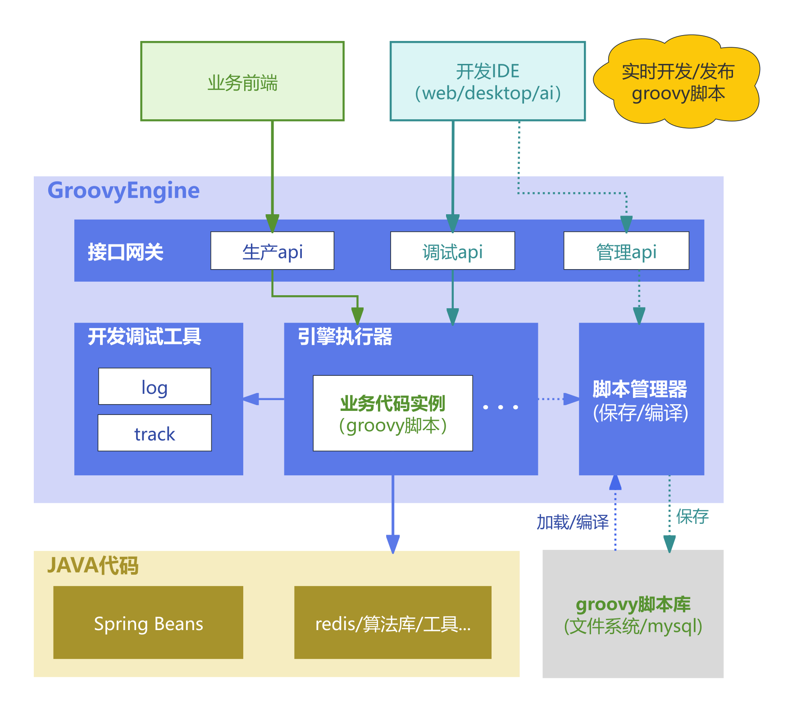

# 架构说明

> 适用范围：独立工程 `groovy-engine`，Git分支 `main`，版本 `1.0.0`。
> 最近源码核验：2026-11-13。本次未启动服务、验证部署或执行HTTP回归。

本引擎让宿主服务的开发人员在不重新打包业务程序的情况下维护动态脚本。宿主负责数据、身份和允许调用的业务能力；引擎负责加载、执行并返回结果。脚本在宿主进程及请求线程中执行，数据库、设备控制等效果属于真实业务执行，“调试”不会自动隔离或撤销效果。

本文描述独立引擎的当前代码。工程 `inxvision-iot-platform` 的内嵌实现有不同Java包名、上下文和鉴权，不以本文代替其规范。图中 `MyContextFactory`、`MyGatewayController` 是宿主需要自行实现的示意Java类，其余核心名称对应文末列出的Java类或接口。

> 作者：凌封 — [https://aibook.ren](https://aibook.ren)（AI全书）

## 架构总览



## 模块架构

```
┌─────────────────────────────────────────────────────────┐
│                    Your Spring Boot App                  │
│                                                          │
│  ┌──────────────────┐   ┌──────────────────────────┐    │
│  │ MyContextFactory │   │  MyGatewayController     │    │
│  │ (IScriptContext  │   │  (extends Abstract...    │    │
│  │  Factory impl)   │   │   GatewayController)     │    │
│  └────────┬─────────┘   └──────────┬───────────────┘    │
│           │                         │                    │
├───────────┼─────────────────────────┼────────────────────┤
│           │  groovy-engine-spring-boot-starter            │
│           │                         │                    │
│  ┌────────┴─────────────────────────┴──────────────────┐ │
│  │            Auto Configuration                        │ │
│  │  ┌─────────────────┐  ┌────────────────────────┐    │ │
│  │  │ ManageController │  │ AuthInterceptor+CORS   │    │ │
│  │  │ (CRUD + Test)    │  │ (X-Groovy-Token)       │    │ │
│  │  └─────────────────┘  └────────────────────────┘    │ │
│  │  ┌─────────────────┐  ┌────────────────────────┐    │ │
│  │  │ JdbcScriptStorage│  │ GroovyEngineProperties │    │ │
│  │  │ (MyBatis-Plus)   │  │ (groovy.engine.*)      │    │ │
│  │  └────────┬────────┘  └────────────────────────┘    │ │
│  └───────────┼──────────────────────────────────────────┘ │
│              │                                            │
├──────────────┼────────────────────────────────────────────┤
│              │  groovy-engine-core （纯 Java）              │
│  ┌───────────┴──────────────────────────────────────────┐ │
│  │                                                       │ │
│  │  ┌──────────────┐  ┌────────────────────┐            │ │
│  │  │ ScriptManager │  │ScriptExecutionSvc  │            │ │
│  │  │ (编译+缓存)    │  │(执行门面+超时控制)   │            │ │
│  │  └──────────────┘  └────────────────────┘            │ │
│  │                                                       │ │
│  │  ┌──────────────┐  ┌─────────────┐ ┌──────────────┐ │ │
│  │  │ BeanAccessor  │  │ScriptTracer │ │IScriptStorage│ │ │
│  │  │ (访问限制)     │  │(追踪工具)    │ │(存储抽象)     │ │ │
│  │  └──────────────┘  └─────────────┘ └──────────────┘ │ │
│  │                                                       │ │
│  │  ┌──────────────────────────────────────────────────┐ │ │
│  │  │ IBusinessScript | IScriptContextFactory (SPI)    │ │ │
│  │  └──────────────────────────────────────────────────┘ │ │
│  └───────────────────────────────────────────────────────┘ │
└─────────────────────────────────────────────────────────────┘
```

## 核心执行流程

```
HTTP Request
    │
    ▼
GatewayController / ManageController
    │
    ▼
ScriptExecutionService.execute(bizCode, params, track)
    │
    ├─ 1. ScriptManager.getScript(bizCode)     → 从缓存获取已编译实例
    │     └─ 缓存未命中 → IScriptStorage.getByBizCode() → 编译 → 缓存
    │
    ├─ 2. IScriptContextFactory.buildContext()  → 构建执行上下文
    │
    ├─ 3. 注入 ScriptTracer + 可选 track 代理   → 追踪能力
    │
    ├─ 4. 调度超时看门狗                         → 线程中断保护
    │
    └─ 5. script.execute(context)               → 执行 Groovy 脚本
          │
          └─ 返回 ScriptResult { code, data, _trace, _track, cost }
```

## ClassLoader 生命周期

```
启动 → 创建 GroovyClassLoader → 预加载所有脚本
  │
  ├─ 单个刷新 → 移除缓存 → 重新编译 → 累计计数+1
  │
  ├─ 达到阈值(100) → 新建类加载器 → 清缓存并预加载启用脚本 → 关闭旧类加载器
  │
  └─ 全量重载 → 新建类加载器 → 清缓存并预加载启用脚本 → 关闭旧类加载器
```

缓存键为业务编码 `bizCode`，缓存值是复用的脚本实例。请求数据必须放在执行方法局部变量中；不能把实例字段当成每次请求的独立状态。关闭旧类加载器不等于立即释放所有类或保证垃圾回收，仍在执行的请求可能持有旧实例。

预加载失败会记录日志并跳过对应脚本，不必然阻止服务启动；刷新全部返回成功也不能代替逐个脚本执行验证。编译计数不包括启动预加载，没有定时查库或多实例刷新广播；直接改数据库、仅在一个服务实例保存，都不能据此认定所有实例已加载相同代码。

## 保存、版本与执行的一致性

| 操作 | 当前实现 | 验收含义 |
| --- | --- | --- |
| 新建 | 写库并设版本1、启用状态，不先编译 | 记录存在不等于可执行 |
| 更新 | 查询记录、可选校验请求版本、版本加1并写库，再移除缓存并重新编译 | 编译失败时数据库保留新内容，返回成功码及错误提示；没有自动恢复上一版 |
| 版本冲突 | 比较已读版本，默认存储再按主键更新 | 可发现顺序发生的旧版本提交，但不是数据库条件更新，不保证并发写入原子互斥 |
| 批量部署 | 逐条创建或更新，最后全量重载 | 无整批事务、逐项编译门禁或一键回滚；失败时需核对部分写入 |
| 停用/删除 | 更新或删除后刷新当前进程缓存 | 其他实例需单独核对；已获得旧实例的在途请求不保证取消 |

默认数据库表 `sys_groovy_script` 对字段 `biz_code` 设置全局唯一约束。字段 `project_code` 仅参与列表筛选，执行、详情及缓存不按项目编码隔离；不能使用相同业务编码实现多个项目的独立版本。按业务编码读取仅返回启用脚本，停用记录再次新建或批量部署还可能遇到数据库唯一约束。

## 上下文、返回值与事务

Java接口 `IScriptContextFactory` 的方法 `buildContext` 由宿主实现，返回本次执行可用的Map；框架额外注入追踪字段 `t`。当前Demo只提供请求参数、示例查询服务、日志和按需获取Bean的工具，没有默认登录用户、Redis或事务模板。IDE显示这些内置提示不证明实际服务提供相应能力。

正式网关合并查询参数和JSON请求体，请求体覆盖同名查询参数，再放入真实请求信息 `_headers`、`_method`、`_uri`。查询参数可能是字符串或多值列表，JSON值保留反序列化后的类型；不能认为所有参数都是字符串。管理调试接口直接接收 `params`，并不经过同一HTTP参数构建路径。

Java结果类 `ScriptResult` 返回业务码、数据、追踪和耗时；业务异常常表现为HTTP 200且业务码500，文件内容则返回字节流。脚本返回一个包含 `code` 字段的普通Map仍只是业务数据，不自动改变外层业务码。验收应检查契约字段和真实业务效果。

事务由宿主按业务需要显式提供，不由引擎默认开启。脚本不是Spring代理，脚本上的事务注解不会自动生效；调用已有事务代理服务或显式使用宿主注入的事务模板，仍受事务管理器、传播行为和线程边界约束。远程调用、消息或设备动作不由本地数据库事务自动撤销。事务扩展写法见[工程说明](../README.md#-脚本中使用事务)。

## 安全机制

### BeanAccessor 白名单

脚本通过 `ctx.getBean.get("beanName")` 获取Bean时，Java类 `BeanAccessor` 检查取得实例的运行时包名是否匹配允许的字符串前缀：

```java
Set<String> allowed = new HashSet<>(Arrays.asList("com.myapp.service"));
ctx.put("getBean", new BeanAccessor(applicationContext, allowed));
```

该检查只约束经此工具获取Bean的路径，不限制已直接注入的引用，也不限制脚本直接使用宿主类路径中的类、文件、网络或反射能力。代码没有独立进程、资源配额或完整的语言沙箱；仅适用于受信任开发者维护的脚本。运行时代理类的包名也可能影响匹配，需针对实际Bean测试，不能仅由接口包名推断可访问。

### 超时保护

配置超时大于0时，编译阶段通过Groovy注解 `@ThreadInterrupt` 对相应代码位置插入中断检查；执行服务调度任务，到期对当前请求线程调用 `interrupt()`，执行结束时取消任务并清理中断标记。默认600秒，Demo配置30秒。

这是协作式中断，不是强制杀死线程。脚本编译、类初始化和上下文构建发生在定时任务注册之前；不响应中断的Java调用、外部阻塞或脚本吞掉中断后继续执行，都不能承诺在指定秒数内结束。应在隔离环境验证所用依赖的超时与取消行为，并验证副作用是否已经发生。

### API Key 鉴权

管理HTTP接口 `/api/groovy/script/**` 检查请求头 `X-Groovy-Token`；未启用管理或密钥为空时返回403，密钥不匹配时返回401。文档分享路径 `/api/groovy/script/doc/share/**` 明确排除该拦截器，因此关闭管理开关不等于关闭分享页面。宿主外围认证与网络访问规则仍可能影响最终结果。

业务网关不由上述管理拦截器保护。Demo未实现业务登录，实际接入方必须按业务配置用户及项目权限。框架默认跨域配置允许所有来源模式并允许凭据，不能把跨域可访问理解为业务授权已经完成。

### 执行追踪

字段 `_trace` 来自脚本显式调用 `ctx.t.log`。启用 `track` 时，只尝试代理补全数据中列出的上下文Bean，并要求运行时类直接提供Java接口；无接口的示例服务可能产生空的 `beanCalls`。记录在方法正常返回后加入，不能作为异常调用、所有内部调用或所有数据访问的完整审计。

## 扩展点

| 接口 | 模块 | 说明 | 是否必须实现 |
|------|------|------|:---:|
| `IScriptContextFactory` | core | 定义脚本执行上下文 | ✅ 必须 |
| `IScriptStorage` | core | 脚本存储抽象 | ❌ 默认 JDBC |
| `AbstractGroovyGatewayController` | starter | 业务网关基类 | ❌ 可选 |

## 验收要求

先在独立Demo执行[最小验收](quick-start.md#最小验收)，再对宿主环境执行以下相关用例；未执行的项必须标为未验证，不能以源码存在代替通过。

| 检查项 | 操作与预期 | 留存证据 |
| --- | --- | --- |
| 新建、保存和实际版本 | 使用独立测试编码；写入可识别版本标记，读回详情，再调试及正式调用 | 业务编码、保存版本、读回源码摘要、请求与响应 |
| 编译失败 | 仅在独立测试记录保存语法错误，检查数据库详情和执行失败；随后恢复可执行源码 | 保存提示、执行业务码、恢复后版本和结果 |
| 顺序版本冲突 | 两个客户端读取同版，先保存一份，再提交旧版 | 冲突响应；不将该用例当成并发CAS保证 |
| 多实例刷新 | 各实例分别执行同一版本标记，核对更新后是否一致 | 实例标识与各自结果；没有逐实例验证时不宣称全量生效 |
| 事务 | 宿主已提供事务能力时验证成功提交、异常和显式回滚 | 前后数据、事务范围、未回滚的外部效果 |
| 追踪和权限 | 核对日志、实际可代理Bean、管理鉴权及正式用户权限 | 请求状态、业务码及可见追踪；不保存真实令牌 |
| 超时 | 在隔离进程使用有界测试任务，记录返回时间与任务是否结束 | 配置、执行日志、耗时及副作用；不得用生产死循环验证 |

## 技术定位

- Java类 [ScriptManager](../groovy-engine-core/src/main/java/cn/fengin/groovy/engine/ScriptManager.java)：编译、实例缓存及类加载器更新。
- Java类 [ScriptExecutionService](../groovy-engine-core/src/main/java/cn/fengin/groovy/engine/ScriptExecutionService.java)：上下文、协作式超时、返回结果和追踪代理。
- Java类 [BeanAccessor](../groovy-engine-core/src/main/java/cn/fengin/groovy/engine/BeanAccessor.java)：Bean运行时包前缀检查。
- Java类 [GroovyScriptManageController](../groovy-engine-spring-boot-starter/src/main/java/cn/fengin/groovy/spring/web/GroovyScriptManageController.java)、[JdbcScriptStorage](../groovy-engine-spring-boot-starter/src/main/java/cn/fengin/groovy/spring/storage/JdbcScriptStorage.java)：先写库后刷新、版本比较及列表筛选。
- Java类 [GroovyWebConfig](../groovy-engine-spring-boot-starter/src/main/java/cn/fengin/groovy/spring/web/GroovyWebConfig.java)、[GroovyScriptAuthInterceptor](../groovy-engine-spring-boot-starter/src/main/java/cn/fengin/groovy/spring/web/GroovyScriptAuthInterceptor.java)：管理鉴权、分享排除和跨域配置。
